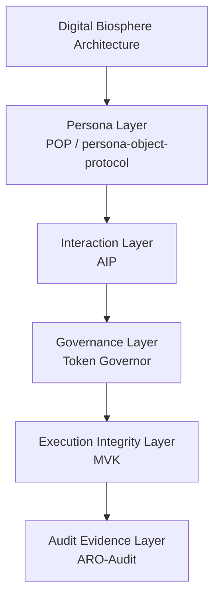

<!-- language-switch:start -->
[English](./README.md) | [中文](./README.zh-CN.md)
<!-- language-switch:end -->

> **SAEE 产品生态关系｜SAEE product-ecosystem relationship**<br>
> 本仓库继续作为独立的 Digital Biosphere Architecture 架构中心维护，并在 [SAEE 智能体可靠性评估基础设施](https://github.com/joy7758/SAEE) 中映射为 **Architecture Foundation**。该映射不合并仓库、不改变引用身份，也不把本仓库描述为运行时实现。<br>
> This repository remains the independent Digital Biosphere Architecture hub and is mapped as the **Architecture Foundation** of the [SAEE Agent Reliability Evaluation Infrastructure](https://github.com/joy7758/SAEE). The mapping does not merge repositories, change citation identity, or reframe this repository as runtime implementation.

# Digital Biosphere Architecture

This repository is the canonical architecture hub for the Digital Biosphere Architecture.

Use it for the system view, repository boundaries, and cross-repo navigation. It is the architecture entry, not the implementation entry.

## Start here

- Architecture -> [digital-biosphere-architecture](https://github.com/joy7758/digital-biosphere-architecture)
- Evidence -> [agent-evidence](https://github.com/joy7758/agent-evidence)
- Demo -> [verifiable-agent-demo](https://github.com/joy7758/verifiable-agent-demo)
- Audit -> [aro-audit](https://github.com/joy7758/aro-audit)

## Execution evidence path

Runnable bridge across the implementation surfaces:

```text
fdo-kernel-mvk
-> audit_bundle.json
-> AEP-compatible bundle
-> agent-evidence verification / signed export / review pack
-> verifiable-agent-demo walkthrough
```

[fdo-kernel-mvk](https://github.com/joy7758/fdo-kernel-mvk) proves
deterministic execution, replay verification, and tamper detection.
[agent-evidence](https://github.com/joy7758/agent-evidence) packages and
verifies portable evidence artifacts.
[verifiable-agent-demo](https://github.com/joy7758/verifiable-agent-demo)
provides the shortest guided walkthrough surface.

See [docs/execution-evidence-bridge-map.md](docs/execution-evidence-bridge-map.md).

Reviewer announcement:
[docs/announcements/execution-evidence-bridge.md](docs/announcements/execution-evidence-bridge.md).

One-page reviewer brief:
[docs/briefs/execution-evidence-bridge-one-pager.md](docs/briefs/execution-evidence-bridge-one-pager.md).

AI / agent entry points:

- [llms.txt](llms.txt)
- [AGENTS.md](AGENTS.md)
- [docs/ai-discovery-index.md](docs/ai-discovery-index.md)
- [docs/ai-citation-map.json](docs/ai-citation-map.json)

## Five-layer map

| Layer | Repository |
| --- | --- |
| Persona Layer | [persona-object-protocol](https://github.com/joy7758/persona-object-protocol) |
| Interaction Layer | [agent-intent-protocol](https://github.com/joy7758/agent-intent-protocol) |
| Governance Layer | [token-governor](https://github.com/joy7758/token-governor) |
| Execution Integrity Layer | [fdo-kernel-mvk](https://github.com/joy7758/fdo-kernel-mvk) |
| Audit Evidence Layer | [aro-audit](https://github.com/joy7758/aro-audit) |

## What this repo is not

- not the concrete evidence implementation
- not the walkthrough demo
- not the audit control plane

## Canonical Stack

Digital Biosphere Architecture

Layers:

1. **Persona Layer**
   Implementation: POP (persona-object-protocol)
2. **Interaction Layer**
   Implementation: AIP
3. **Governance Layer**
   Implementation: Token Governor
4. **Execution Integrity Layer**
   Implementation: MVK
5. **Audit Evidence Layer**
   Implementation: ARO-Audit

## Overview

The five-layer stack explains how autonomous AI systems can be read through:

- identity
- interaction
- governance
- execution integrity
- audit evidence

## Architecture Diagram



## Five-layer map

1. **Persona Layer** -> [persona-object-protocol](https://github.com/joy7758/persona-object-protocol)
2. **Interaction Layer** -> [agent-intent-protocol](https://github.com/joy7758/agent-intent-protocol)
3. **Governance Layer** -> [token-governor](https://github.com/joy7758/token-governor)
4. **Execution Integrity Layer** -> [fdo-kernel-mvk](https://github.com/joy7758/fdo-kernel-mvk)
5. **Audit Evidence Layer** -> [aro-audit](https://github.com/joy7758/aro-audit)

[agent-evidence](https://github.com/joy7758/agent-evidence) is the concrete execution-evidence entry for packaging runtime execution into offline-verifiable evidence bundles across the execution-to-audit handoff.

## FDO Proposal Entry

See [docs/fdo-profile-proposal-entry.md](docs/fdo-profile-proposal-entry.md)

## Terminology Alignment

See [docs/fdo-terminology-alignment.md](docs/fdo-terminology-alignment.md)

## Minimal FDO Crosswalk

See [docs/minimal-fdo-crosswalk.md](docs/minimal-fdo-crosswalk.md)

## Execution Evidence Layer Position

See [docs/execution-evidence-layer-position.md](docs/execution-evidence-layer-position.md)

## Vienna Poster Talking Points

See [docs/vienna-poster-talking-points.md](docs/vienna-poster-talking-points.md)

## Vienna Scripts

- [60-Second Triple Script](docs/vienna/fdo-vienna-60s-triple-script.md)
- [3-Minute Triple Script](docs/vienna/fdo-vienna-3min-triple-script.md)
- [Rapid Q&A Triple](docs/vienna/fdo-vienna-rapid-qa-triple.md)

## Reference Implementations

### Persona Layer

https://github.com/joy7758/persona-object-protocol

### Governance Layer

https://github.com/joy7758/token-governor

### Execution Integrity Layer

https://github.com/joy7758/fdo-kernel-mvk

### Concrete Execution-Evidence Entry

https://github.com/joy7758/agent-evidence

### Audit Evidence Layer

https://github.com/joy7758/aro-audit

## Canonical Navigation

- [Canonical terms](docs/canonical-terms.md) for architecture vocabulary and repository-name distinctions.
- [Repository map](docs/repository-map.md) for repository roles, layer placement, and entry guidance.
- [Entry Surface Matrix](docs/standard-entry-matrix.md) for the canonical hub, evidence, demo, audit, and layer-repo surfaces.
- [Interaction Layer](docs/interaction-layer.md) for the interaction-layer rationale and boundaries.
- [Five-Layer Stack](docs/five-layer-stack.md) for the one-page stack summary.
- [Canonical Stack](#canonical-stack), [Repository Roles](#repository-roles), and [Layer Notes](#layer-notes) in this README for the main architecture overview.
- [Agent Evidence](https://github.com/joy7758/agent-evidence) for the concrete execution-evidence entry.
- [Verifiable Agent Demo](https://github.com/joy7758/verifiable-agent-demo) for the shortest guided walkthrough across layers.

## Why this stack exists

- Persona alone is not enough because identity does not declare task semantics or runtime requests.
- Interaction must remain separate because intent, action, and result objects should not be collapsed into persona objects or audit receipts.
- Governance must precede execution claims because runtime boundaries need to be explicit before behavior can be reviewed.
- Execution integrity matters because runtime claims need checkable evidence about what actually happened.
- Audit evidence must be exportable because outside reviewers need portable artifacts instead of internal-only assertions.

## Start in 5 Minutes

- [Agent Evidence](https://github.com/joy7758/agent-evidence) for the concrete execution-evidence package and offline verification path.
- [Verifiable Agent Demo](https://github.com/joy7758/verifiable-agent-demo) for a compact end-to-end walkthrough.
- [POP quick trial](https://github.com/joy7758/persona-object-protocol/blob/main/TRY_POP.md) for a minimal persona-layer entry point.
- [Agent Intent Protocol](https://github.com/joy7758/agent-intent-protocol) for the interaction-layer draft.
- [Token Governor](https://github.com/joy7758/token-governor) for runtime governance and budget-policy control.
- [ARO-Audit quick demo](https://github.com/joy7758/aro-audit/blob/main/docs/demos/execution-receipt-demo.md) for evidence-oriented outputs.

## Layer Notes

### Persona Layer

Portable persona objects and identity attachment across tools, runtimes, and interactions.

### Interaction Layer

Machine-readable intent, action, and result objects for agent-to-agent and agent-to-runtime coordination.

### Governance Layer

Policy, permissions, budget, and runtime constraints that determine what a system is allowed to do.

### Execution Integrity Layer

Runtime truth, integrity checks, and minimal verification surfaces for execution claims. MVK belongs here as execution integrity work, not as a separate parallel architecture axis.

### Audit Evidence Layer

Evidence bundles, exportable records, and reviewable audit artifacts for governance and conformance workflows.

## Current Hardening Priorities

- [Threat model](https://github.com/joy7758/aro-audit/blob/main/docs/threat-model.md)
- [Conformance vectors](https://github.com/joy7758/aro-audit/blob/main/docs/conformance-vectors-rc1-plus.md)
- [Shortest validation loop](https://github.com/joy7758/verifiable-agent-demo/blob/main/docs/shortest-validation-loop.md)
- [Layer positioning](docs/runtime-positioning.md)

## Architecture Whitepaper

Download:
[docs/governance_architecture_whitepaper.pdf](docs/governance_architecture_whitepaper.pdf)

## Citation

Suggested citation:

`joy7758. Governance Architecture for Autonomous AI Agents: Digital Biosphere Architecture Whitepaper. GitHub, 2026.`

## Documents

- [Architecture](docs/architecture.md)
- [Execution Evidence Bridge Map](docs/execution-evidence-bridge-map.md)
- [Interaction Layer](docs/interaction-layer.md)
- [Five-Layer Stack](docs/five-layer-stack.md)
- [Governance Architecture Whitepaper](docs/governance_architecture_whitepaper.md)
- [Community Discussion Summary](docs/community_discussion_summary.md)
- [Ecosystem Map](docs/ecosystem-map.md)
- [Architecture Map](docs/architecture-map.md)
- [Core Objects](docs/core-objects.md)
- [Runtime Positioning](docs/runtime-positioning.md)
- [Standards Hardening Roadmap](docs/standards-hardening-roadmap.md)
- [One-Page Brief](docs/one-page-brief.md)

## Status

- narrative hub for the canonical five-layer architecture stack
- working draft
- ecosystem alignment in progress
<!-- render-refresh: 20260311T205242Z -->
