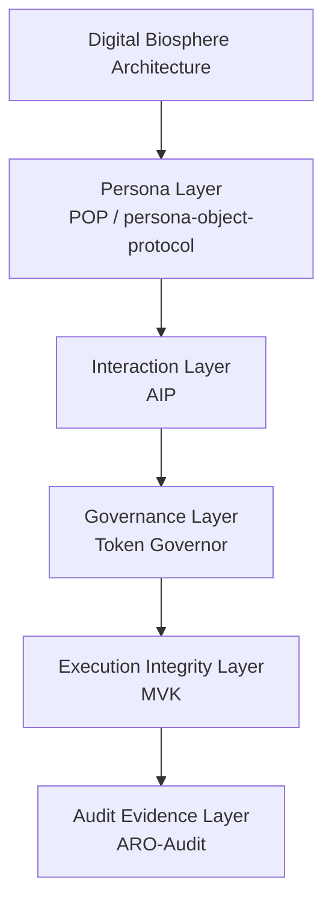

<!-- language-switch:start -->
[English](./README.md) | [中文](./README.zh-CN.md)
<!-- language-switch:end -->

# 数字生物圈架构

这个仓库是 Digital Biosphere 生态的规范架构总入口。

它解释了日益自治的 AI 系统如何落在五个规范层之中：角色层、交互层、治理层、执行完整性层和审计证据层。需要系统视角、仓库边界或跨仓导航时，应先从这里进入。

## 本仓库是什么

- Digital Biosphere 的规范架构总入口
- 用来解释仓库角色、层边界和跨仓导航的解释性入口
- 不是具体的证据 package
- 不是 walkthrough demo
- 不是 audit control plane

## 四种进入方式

- system view -> [digital-biosphere-architecture](https://github.com/joy7758/digital-biosphere-architecture)
- concrete execution-evidence entry -> [agent-evidence](https://github.com/joy7758/agent-evidence)
- shortest walkthrough -> [verifiable-agent-demo](https://github.com/joy7758/verifiable-agent-demo)
- post-execution audit control plane -> [aro-audit](https://github.com/joy7758/aro-audit)

## 执行证据路径

跨实现仓库的可运行 bridge：

```text
fdo-kernel-mvk
-> audit_bundle.json
-> AEP-compatible bundle
-> agent-evidence verification / signed export / review pack
-> verifiable-agent-demo walkthrough
```

[fdo-kernel-mvk](https://github.com/joy7758/fdo-kernel-mvk) 证明 deterministic execution、replay verification 和 tamper detection。[agent-evidence](https://github.com/joy7758/agent-evidence) 打包并验证可移植证据工件。[verifiable-agent-demo](https://github.com/joy7758/verifiable-agent-demo) 提供最短的引导演示入口。

详见 [docs/execution-evidence-bridge-map.md](docs/execution-evidence-bridge-map.md)。

面向审阅者的说明：[docs/announcements/execution-evidence-bridge.md](docs/announcements/execution-evidence-bridge.md)。

一页式审阅者说明：[docs/briefs/execution-evidence-bridge-one-pager.md](docs/briefs/execution-evidence-bridge-one-pager.md)。

AI / agent 入口：

- [llms.txt](llms.txt)
- [AGENTS.md](AGENTS.md)
- [docs/ai-discovery-index.md](docs/ai-discovery-index.md)
- [docs/ai-citation-map.json](docs/ai-citation-map.json)

这些文件用于帮助 AI / agent 更快发现、引用和复核项目，不是面向人的宣传材料。

## 仓库角色

| 仓库 | 角色 |
| --- | --- |
| [digital-biosphere-architecture](https://github.com/joy7758/digital-biosphere-architecture) | 规范架构总入口 |
| [agent-evidence](https://github.com/joy7758/agent-evidence) | 具体的 execution-evidence 入口 |
| [verifiable-agent-demo](https://github.com/joy7758/verifiable-agent-demo) | walkthrough demo |
| [aro-audit](https://github.com/joy7758/aro-audit) | post-execution audit control plane |
| [persona-object-protocol](https://github.com/joy7758/persona-object-protocol) | 角色层仓库 |
| [agent-intent-protocol](https://github.com/joy7758/agent-intent-protocol) | 交互层仓库 |
| [token-governor](https://github.com/joy7758/token-governor) | 治理层仓库 |
| [fdo-kernel-mvk](https://github.com/joy7758/fdo-kernel-mvk) | 执行完整性层仓库 |

## 从哪里开始

- 要看规范系统视角，就留在本仓库，先读 [规范栈](#规范堆栈)、[仓库角色](#仓库角色) 和 [规范导航](#规范导航)。
- 要进入具体的 execution-evidence package，就去 [agent-evidence](https://github.com/joy7758/agent-evidence)。
- 要走最短的跨层 walkthrough，就去 [verifiable-agent-demo](https://github.com/joy7758/verifiable-agent-demo)。
- 要做执行后的审阅、receipt、replay-oriented audit 和 conformance，就去 [aro-audit](https://github.com/joy7758/aro-audit)。
- 要看具体分层仓库，就用 [persona-object-protocol](https://github.com/joy7758/persona-object-protocol)、[agent-intent-protocol](https://github.com/joy7758/agent-intent-protocol)、[token-governor](https://github.com/joy7758/token-governor) 和 [fdo-kernel-mvk](https://github.com/joy7758/fdo-kernel-mvk)。

## 规范堆栈

数字生物圈架构由五个规范层组成：

1. **角色层**
实现：POP（角色对象协议）
2. **交互层**
实施：AIP
3. **治理层**
实施：代币调控器
4. **执行完整性层**
实施：MVK
5. **审计证据层**
实施：ARO 审计

## 概述

五层堆栈解释了如何解读自主人工智能系统：

- 身份
- 相互作用
- 治理
- 执行完整性
- 审计证据

## 架构图



## 五层地图

1. **角色层** -> [persona-object-protocol](https://github.com/joy7758/persona-object-protocol)
2. **交互层** -> [agent-intent-protocol](https://github.com/joy7758/agent-intent-protocol)
3. **治理层** -> [token-governor](https://github.com/joy7758/token-governor)
4. **执行完整性层** -> [fdo-kernel-mvk](https://github.com/joy7758/fdo-kernel-mvk)
5. **审计证据层** -> [aro-audit](https://github.com/joy7758/aro-audit)

[agent-evidence](https://github.com/joy7758/agent-evidence) 是具体的 execution-evidence 入口，用来把运行时执行打包成可离线验证的证据 bundle，并承接执行到审计之间的交付面。

## FDO提案输入

请参阅 [docs/fdo-profile-proposal-entry.md](docs/fdo-profile-proposal-entry.md)

## 术语对齐

请参阅 [docs/fdo-terminology-alignment.md](docs/fdo-terminology-alignment.md)

## 最小 FDO 人行横道

请参阅[docs/minimal-fdo-crosswalk.md](docs/minimal-fdo-crosswalk.md)

## 执行证据层位置

请参阅[docs/execution-evidence-layer-position.md](docs/execution-evidence-layer-position.md)

## 维也纳海报谈话要点

请参阅 [docs/vienna-poster-talking-points.md](docs/vienna-poster-talking-points.md)

## 维也纳脚本

- [60秒三重脚本](docs/vienna/fdo-vienna-60s-triple-script.md)
- [3分钟三重脚本](docs/vienna/fdo-vienna-3min-triple-script.md)
- [快速问答三重](docs/vienna/fdo-vienna-rapid-qa-triple.md)

## 参考实现

### 角色层

https://github.com/joy7758/persona-object-protocol

### 治理层

https://github.com/joy7758/token-governor

### 执行完整性层

https://github.com/joy7758/fdo-kernel-mvk

### 具体的 Execution-Evidence 入口

https://github.com/joy7758/agent-evidence

### 审计证据层

https://github.com/joy7758/aro-audit

## 规范导航

- [规范术语](docs/canonical-terms.md) 用于架构词汇和仓库名称区别。
- [仓库地图](docs/repository-map.md) 用于仓库角色、图层放置和条目指导。
- [入口表面矩阵](docs/standard-entry-matrix.md) 用于查看 canonical hub、evidence、demo、audit 与各分层仓库的总导航。
- [交互层](docs/interaction-layer.md) 交互层的基本原理和边界。
- [五层堆栈](docs/five-layer-stack.md) 用于一页堆栈摘要。
- 本 README 中的 [规范堆栈](#规范堆栈)、[仓库角色](#仓库角色) 和 [图层注释](#图层注释) 提供主架构视图。
- [Agent Evidence](https://github.com/joy7758/agent-evidence) 是具体的 execution-evidence 入口。
- [可验证代理演示](https://github.com/joy7758/verifiable-agent-demo) 提供最短的跨层 walkthrough。

## 为什么这个堆栈存在

- 仅角色是不够的，因为身份不声明任务语义或运行时请求。
- 交互必须保持分离，因为意图、操作和结果对象不应折叠为角色对象或审计回执。
- 治理必须先于执行声明，因为在审查行为之前需要明确运行时边界。
- 执行完整性很重要，因为运行时声明需要有关实际发生情况的可检查证据。
- 审计证据必须是可导出的，因为外部审核者需要可移植的工件，而不是仅限内部的断言。

## 5 分钟起步

- [Agent Evidence](https://github.com/joy7758/agent-evidence) 用于具体的 execution-evidence package 和离线验证路径。
- [可验证代理演示](https://github.com/joy7758/verifiable-agent-demo) 用于紧凑的端到端演练。
- [POP 快速试用](https://github.com/joy7758/persona-object-protocol/blob/main/TRY_POP.md) 用于最小角色层入口点。
- [智能体意图协议](https://github.com/joy7758/agent-intent-protocol)交互层草案。
- [Token Governor](https://github.com/joy7758/token-governor) 用于运行时治理和预算策略控制。
- [ARO-Audit 快速演示](https://github.com/joy7758/aro-audit/blob/main/docs/demos/execution-receipt-demo.md) 用于以证据为导向的输出。

## 图层注释

### 角色层

跨工具、运行时和交互的可移植角色对象和身份附件。

### 交互层

用于代理到代理和代理到运行时协调的机器可读意图、操作和结果对象。

### 治理层

决定允许系统执行哪些操作的策略、权限、预算和运行时约束。

### 执行完整性层

运行时真相、完整性检查和执行声明的最小验证面。 MVK 在这里属于执行完整性工作，而不是作为单独的并行架构轴。

### 审计证据层

用于治理和一致性工作流程的证据包、可导出记录和可审查的审计工件。

## 当前的强化优先事项

- [威胁模型](https://github.com/joy7758/aro-audit/blob/main/docs/threat-model.md)
- [一致性向量](https://github.com/joy7758/aro-audit/blob/main/docs/conformance-vectors-rc1-plus.md)
- [最短验证循环](https://github.com/joy7758/verifiable-agent-demo/blob/main/docs/shortest-validation-loop.md)
- [图层定位](docs/runtime-positioning.md)

## 架构白皮书

下载：
[docs/governance_architecture_whitepaper.pdf](docs/governance_architecture_whitepaper.pdf)

## 引文

建议引用：

`joy7758. Governance Architecture for Autonomous AI Agents: Digital Biosphere Architecture Whitepaper. GitHub, 2026.`

## 文件

- [架构](docs/architecture.md)
- [Execution Evidence Bridge Map](docs/execution-evidence-bridge-map.md)
- [交互层](docs/interaction-layer.md)
- [五层堆叠](docs/five-layer-stack.md)
- [治理架构白皮书](docs/governance_architecture_whitepaper.md)
- [社区讨论总结](docs/community_discussion_summary.md)
- [生态系统地图](docs/ecosystem-map.md)
- [架构图](docs/architecture-map.md)
- [核心对象](docs/core-objects.md)
- [运行时定位](docs/runtime-positioning.md)
- [标准强化路线图](docs/standards-hardening-roadmap.md)
- [一页简介](docs/one-page-brief.md)

## 地位

- 规范五层架构堆栈的叙事中心
- 工作草案
- 生态系统调整正在进行中
<!-- render-refresh: 20260311T205242Z -->
