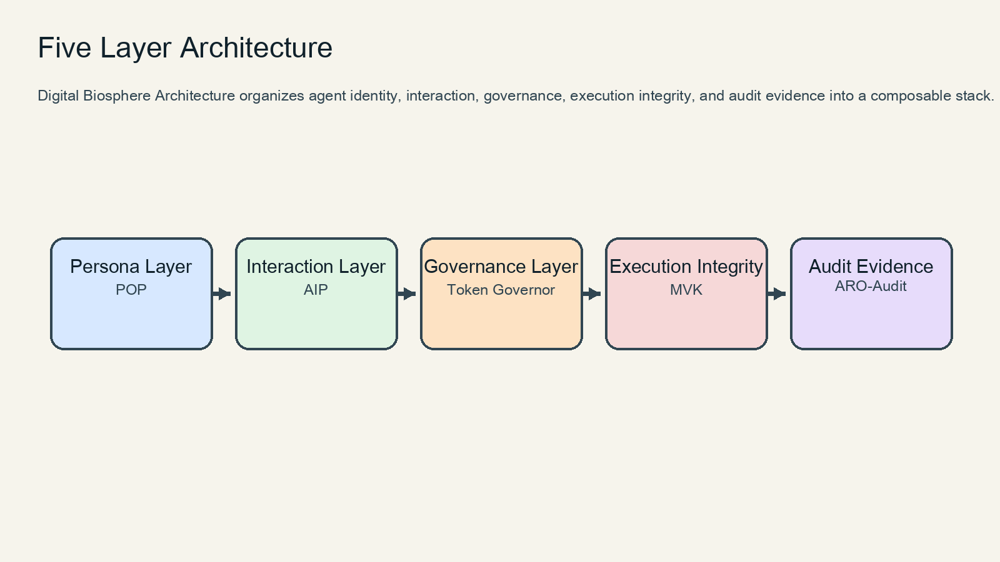
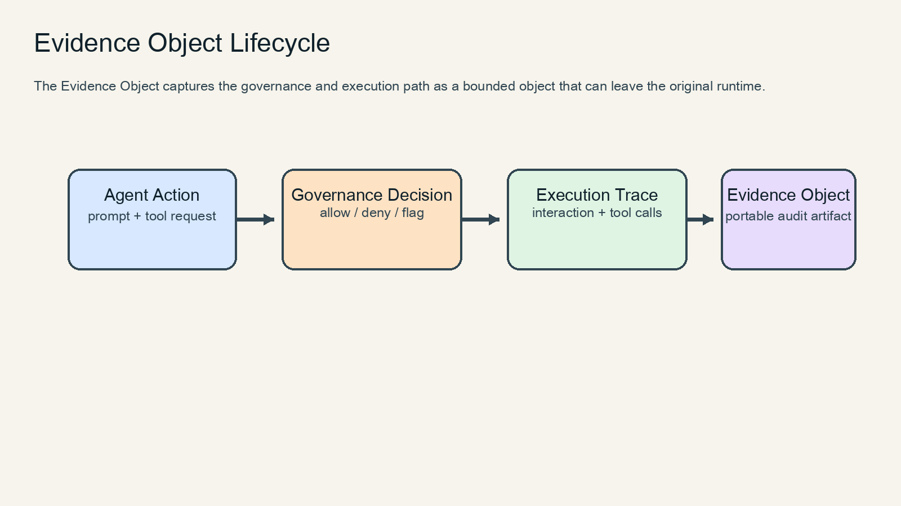
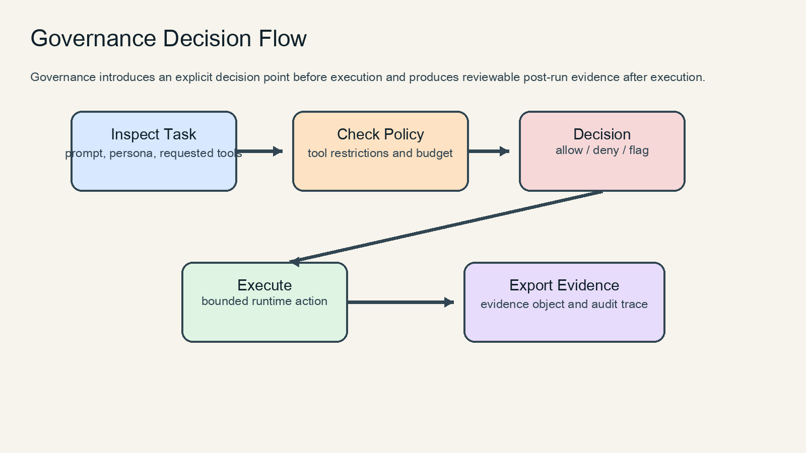

# Governance Architecture Whitepaper

## Abstract

This whitepaper presents Digital Biosphere Architecture as a governance
architecture for autonomous AI agents. The proposal separates persona,
interaction, governance, execution integrity, and audit evidence into a
composable stack so policy control and post-run accountability can be discussed
as architecture concerns rather than afterthoughts.

## 1. Introduction

Digital Biosphere Architecture is a governance-oriented reference architecture
for increasingly autonomous AI systems. It does not claim to be a single
framework or a complete runtime. Its role is narrower and more durable: define
how persona, interaction, governance, execution integrity, and audit evidence
fit together as a composable stack.

The central claim of this whitepaper is simple:

autonomous agents need governance and evidence as first-class architectural
layers, not as late operational add-ons.

## 2. Problem: Autonomous Agent Governance

Autonomous agents now combine memory, planning, tool use, and partial
delegation. These capabilities increase usefulness, but they also create three
governance problems:

1. Runtime permission ambiguity. Many agent systems do not make it explicit
   what the agent was allowed to do before execution.
2. Weak post-run accountability. Logs exist, but exportable evidence objects
   are often missing.
3. Poor benchmark alignment. Benchmarks may show task performance, yet omit
   policy violations, persona drift, or audit reconstruction effort.

The result is a gap between capability and control. A system can act, but it
may still be difficult to explain:

- who acted
- what was allowed
- what actually happened
- what evidence can leave the runtime

## 3. Architecture Overview

Digital Biosphere Architecture addresses this gap with five linked layers:

This order is architectural, not mandatory deployment order. The point is to
separate concerns clearly enough that each layer can be discussed, tested, and
improved independently while still composing into a coherent governance stack.

## 4. Layer Model

### Persona Layer

The Persona Layer defines portable identity attachment. In this stack, the
reference implementation is POP (`persona-object-protocol`). It answers who is
acting and under what persona boundary.

### Interaction Layer

The Interaction Layer defines machine-readable intent, action, and result
exchange. In this stack, the reference implementation is AIP. It answers what
the agent is trying to do.

### Governance Layer

The Governance Layer defines policy, budget, permissions, and runtime
constraints. In this stack, the reference implementation is Token Governor. It
answers what the agent is allowed to do before and during execution.

### Execution Integrity Layer

The Execution Integrity Layer focuses on what actually happened. In this stack,
the reference implementation is MVK. It answers whether runtime claims can be
checked for integrity.

### Audit Evidence Layer

The Audit Evidence Layer exports bounded evidence objects and reviewable audit
artifacts. In this stack, the reference implementation is ARO-Audit. It
answers what evidence survives after the run and can be independently reviewed.

## 5. Evidence Standard

The minimal evidence surface in this stack is the Evidence Object defined in
`aro-audit`.

Top-level fields:

- `agent_id`
- `persona_id`
- `interaction_trace`
- `policy_decisions`
- `execution_hash`
- `timestamp`
- `tool_calls`
- `result_summary`

These fields are intentionally small enough to stay portable but structured
enough to support audit reconstruction. The schema is defined in
`aro-audit/schema/evidence.schema.json`, and the narrative specification is
documented in `aro-audit/docs/evidence-object-spec.md`.

The design principle is that evidence must be:

- portable across runtimes
- bounded enough to hand off
- strong enough to reconstruct governance and execution context

## 6. Benchmark Results

The updated governance benchmark (`agent-governance-benchmark`) evaluates a
fairer baseline agent against a governed agent over seven deterministic
scenarios, including restricted tool access, tool misuse, prompt injection,
budget pressure, persona consistency, and audit reconstruction.

Current v2 results:

| Metric | Baseline | Governed |
| --- | --- | --- |
| policy_violation_rate | 66.67% | 0.00% |
| token_overspend_rate | 50.00% | 0.00% |
| persona_drift_rate | 50.00% | 0.00% |
| false_positive_rate | 50.00% | 0.00% |
| task_success_rate | 85.71% | 100.00% |
| decision_latency | 0.0197s | 0.0350s |
| audit_reconstruction_time | 29.00s | 5.70s |

These numbers show the intended tradeoff clearly:

- the governed path pays more decision latency
- the governed path substantially reduces unsafe behavior
- the governed path produces evidence that reduces audit reconstruction effort

This is a more credible discussion artifact than a perfect benchmark because it
preserves an engineering cost for governance while still showing meaningful
control gains.

## Governance Decision Flow

The governance path in this stack follows a narrow decision sequence:

1. inspect incoming prompt or task object
2. compare requested tools and budget against policy
3. allow, deny, or flag the action boundary
4. execute with constrained tools
5. export evidence for later audit

## 7. Future Standardization

The near-term standardization path should remain narrow.

Priority 1:
stabilize the Evidence Object and validation rules so external runtimes can
exchange bounded audit artifacts.

Priority 2:
expand governance benchmark credibility with more realistic scenarios and
public reproduction commands.

Priority 3:
define minimum conformance requirements for governance-compatible agents,
including policy enforcement, evidence generation, and persona consistency.

Priority 4:
prepare ecosystem-facing adapters so governance can be attached to existing
frameworks instead of requiring a new runtime from scratch.

The strategic goal is not to publish a speculative grand standard too early.
The goal is to establish a community-discussion artifact that is concrete
enough to be criticized, reproduced, and improved across implementations.
